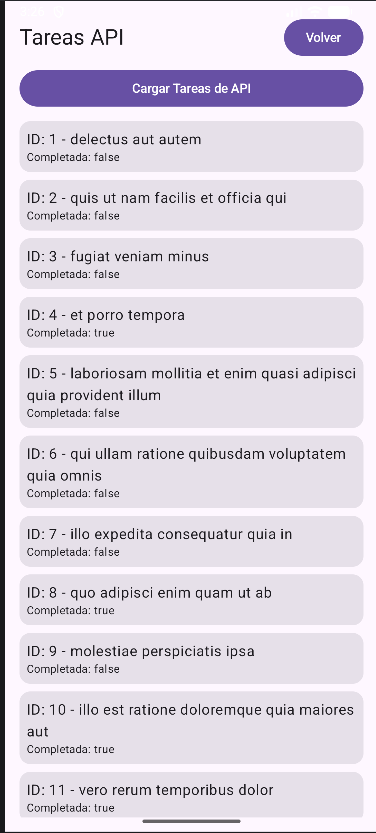
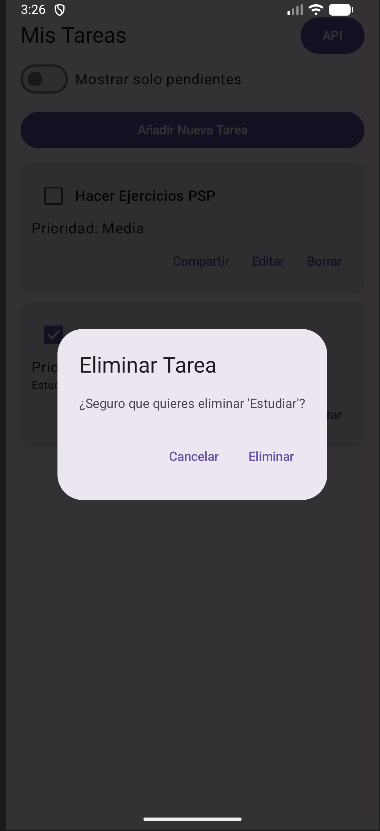

# Gestor Personal de Tareas

## 1. Nombre y descripción de la aplicación
**Nombre:** Gestor Personal de Tareas
**Descripción:** Aplicación Android desarrollada en Kotlin y Jetpack Compose que permite organizar y gestionar tareas personales, académicas o profesionales. El usuario puede registrar, consultar, modificar, marcar como completadas y eliminar tareas. Incorpora almacenamiento permanente, preferencias de usuario, consultas a un servicio web REST y la posibilidad de compartir tareas mediante otras aplicaciones instaladas en el dispositivo

## 2. Funcionalidades implementadas
- **CRUD completo:** Creación, lectura, edición y eliminación de tareas
- **Persistencia local:** Almacenamiento de tareas mediante la librería Room
- **Preferencias:** Uso de DataStore para guardar la preferencia "Mostrar solo pendientes"
- **Consultas de red:** Consumo de la API pública JSONPlaceholder mediante Retrofit
- **Compartir:** Uso de un Intent implícito (`ACTION_SEND`) para compartir tareas
- **Validación:** Comprobación de que el título no esté vacío y tenga al menos 3 caracteres
- **Navegación:** Navegación basada en estados con Compose sin librerías externas

## 3. Organización básica del proyecto
- `data/`: Contiene la entidad `Tarea`, el `TareaDao` y la clase `AppDatabase` (Room)
- `network/`: Contiene la interfaz `ApiTareas` y la configuración de Retrofit
- `preferences/`: Contiene la clase `Preferencias` para gestionar DataStore
- `MainActivity.kt`: Contiene las pantallas Compose (lista, formulario, API) y la lógica de navegación

## 4. Bibliotecas utilizadas
- Jetpack Compose (Material 3) para la interfaz
- Room para la base de datos local
- DataStore para las preferencias
- Retrofit y Gson para las peticiones de red
- Coroutines y Flow para la asincronía

## 5. Instrucciones para ejecutar la aplicación
1. Clonar el repositorio
2. Abrir el proyecto en Android Studio
3. Sincronizar Gradle
4. Ejecutar la aplicación en un emulador (API 24 o superior) o dispositivo físico
5. Opcional: Instalar el APK de depuración (`app-debug.apk`) incluido en el repositorio

## 6. Configuraciones de los dos emuladores utilizados
- **Emulador 1 (Pantalla compacta):** Medium Phone, API 34
- **Emulador 2 (Pantalla grande):** Medium Tablet, API 34

## 7. Tabla de pruebas realizadas y resultados obtenidos
| Nº | Prueba | Resultado esperado | Resultado obtenido | Estado |
|---|---|---|---|---|
| 1 | Crear tarea válida | Se guarda y aparece en la lista. | Correcto | ✅ |
| 2 | Intentar guardar título vacío | Muestra error, no se crea. | Correcto | ✅ |
| 3 | Editar tarea | Cambios reflejados y guardados. | Correcto | ✅ |
| 4 | Marcar como completada | El estado cambia y se guarda. | Correcto | ✅ |
| 5 | Cancelar eliminación | La tarea no desaparece. | Correcto | ✅ |
| 6 | Eliminar tarea confirmando | La tarea desaparece. | Correcto | ✅ |
| 7 | Cerrar y abrir app | Se recuperan las tareas guardadas. | Correcto | ✅ |
| 8 | Activar filtro y reiniciar | Se conserva la preferencia. | Correcto | ✅ |
| 9 | Consultar API con Internet | Muestra las tareas recibidas. | Correcto | ✅ |
| 10 | Consultar API sin conexión | Muestra error y permite reintentar. | Correcto | ✅ |
| 11 | Compartir tarea | Se abre el selector de apps. | Correcto | ✅ |
| 12 | Cambiar orientación | La app sigue funcionando y conserva datos. | Correcto | ✅ |

## 8. Enlace al chat de IA usado durante el desarrollo
https://chat.deepseek.com/share/b1e6a60qmpc750bkff

## 9. Incidencias conocidas o funcionalidades no completadas
- Ninguna incidencia bloqueante. Todas las funcionalidades requeridas han sido implementadas y probadas con éxito en ambos emuladores

## 10. Capturas de pantalla

**Listado principal:**

**Formulario de creación con validación:**

**Consulta a la API:**

**Interacción relevante (Diálogo de borrado):**

